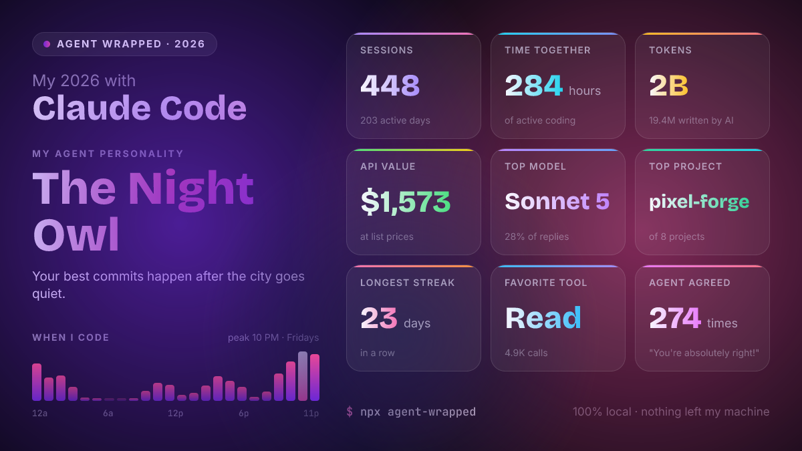
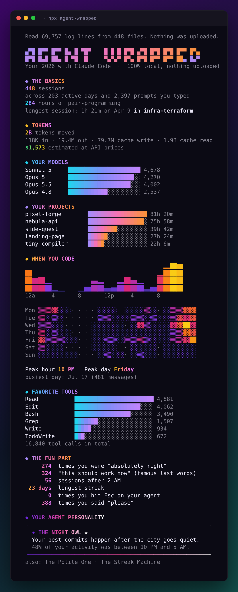
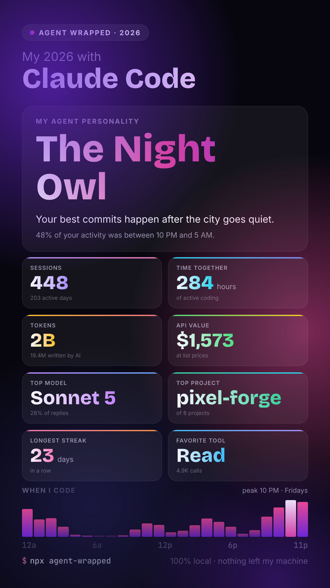

<div align="center">

# 🎁 agent-wrapped

### Spotify Wrapped for your AI coding agent.

**One command turns a year of Claude Code sessions into a stunning, shareable card. 100% local: nothing ever leaves your machine.**

[](https://www.npmjs.com/package/agent-wrapped)
[](https://github.com/7suheel/agent-wrapped/actions/workflows/ci.yml)
[](#-privacy-100-local-nothing-leaves-your-machine)
[](LICENSE)



<sub>Example card generated from a fake year of logs (<code>npm run demo</code>). Yours will be gloriously real.</sub>

</div>

---

<p align="center">
  
</p>
<p align="center"><sub>Recorded with <a href="https://github.com/charmbracelet/vhs">VHS</a> on a generated fake year (<a href="docs/demo.tape"><code>docs/demo.tape</code></a>, <code>npm run demo:gif</code>).</sub></p>

## ⚡ Quick start

```bash
npx agent-wrapped
```

That's it. No install, no sign-up, no API key. You get:

1. An animated, Wrapped-style reveal of your year right in your terminal.
2. Two PNG cards in the current folder, ready to post:
   - `agent-wrapped-2026.png` (1200×675, for X / LinkedIn)
   - `agent-wrapped-2026-story.png` (1080×1920, for Instagram / TikTok stories)

Needs Node.js 18 or newer and [Claude Code](https://claude.com/claude-code) logs on your machine.

## 🔒 Privacy: 100% local, nothing leaves your machine

Your agent logs contain your prompts, your code and your file paths. They are nobody's business but yours, so agent-wrapped is built to never touch the network:

- ✅ **Reads local files only**: the `.jsonl` session logs Claude Code already keeps in `~/.claude/projects`.
- ✅ **No network requests. None.** No telemetry, no analytics, no "anonymous usage stats", no update checks. Fonts are bundled, the card is rendered on your CPU.
- ✅ **Never stores your text.** Prompts and replies are scanned for a few fun phrases while reading and then discarded; only counts are kept.
- ✅ **You decide what you share.** The card shows only the numbers you see in the terminal. Add `--hide-projects` to keep project names off it.
- ✅ **Small and auditable.** Two runtime dependencies ([satori](https://github.com/vercel/satori) and [resvg-js](https://github.com/yisibl/resvg-js)) and a few hundred lines of TypeScript you can read in one sitting.

Don't trust us, check it: `grep -rnE "fetch|https?" src/` finds nothing, and the CLI runs fine with your Wi-Fi off.

## 📊 What's in your Wrapped

|                         |                                                                                                                                                                                      |
| ----------------------- | ------------------------------------------------------------------------------------------------------------------------------------------------------------------------------------ |
| 🗓️ **The basics**       | Sessions, active days, total hands-on time, your longest session                                                                                                                     |
| 🪙 **Tokens**           | Input, output, cache writes and reads, plus an **estimated cost** at API list prices                                                                                                 |
| 🧠 **Models**           | Your most used model and the full breakdown                                                                                                                                          |
| 📁 **Projects**         | The repos you spent the most time in                                                                                                                                                 |
| 🕑 **When you code**    | Most productive hour and weekday, an hour-of-day chart and a week × hour heatmap                                                                                                     |
| 🛠️ **Tools**            | Edit, Bash, Read, Grep, subagents, MCP tools... ranked                                                                                                                               |
| 😂 **The fun part**     | How often your agent said _"You're absolutely right!"_, _"This should work now"_, sessions after 2 AM, your longest daily streak, how often you hit Esc, how often you said "please" |
| 🦉 **Your personality** | An archetype based on how you actually work (see below)                                                                                                                              |

## 🦉 Agent personalities

Each archetype has a threshold; the one you beat by the widest margin is yours, and the runners-up show up as extra traits.

| Personality                   | You get it when...                                                  |
| ----------------------------- | ------------------------------------------------------------------- |
| 🦉 **The Night Owl**          | 30%+ of your activity is between 10 PM and 5 AM                     |
| 🌅 **The Early Bird**         | 22%+ of your activity is between 5 and 9 AM                         |
| 🔥 **The Token Burner**       | You burn $60+ worth of tokens per active day                        |
| ♻️ **The Refactorer**         | A third of all tool calls are edits (30+ calls)                     |
| 🐚 **The Shell Whisperer**    | 42%+ of tool calls are shell commands                               |
| 🔍 **The Code Archaeologist** | Nearly half of all tool calls are reading and searching code        |
| 🧑‍✈️ **The Delegator**          | You send out 1.2+ subagents per session on average                  |
| 🏃 **The Marathoner**         | Your longest session runs 5+ hours of active work                   |
| 🎮 **The Weekend Warrior**    | 36%+ of your activity is on weekends                                |
| 📅 **The Streak Machine**     | 21+ days in a row                                                   |
| 💅 **The Always Right**       | Your agent tells you you're absolutely right 1.5+ times per session |
| 🤹 **The Juggler**            | 10+ projects                                                        |
| 🙏 **The Polite One**         | A "please" or "thanks" for every ~3 prompts (20+ prompts)           |
| 🧘 **The Pragmatist**         | Nothing extreme. Balanced, steady, shipping                         |
| 🌱 **The Fresh Start**        | Fewer than 3 sessions so far                                        |

Got an idea for a funnier one? [It's a 10-line PR.](CONTRIBUTING.md#good-first-contributions)

## 🖼️ Example output

<details>
<summary><b>Terminal</b> (click to expand)</summary>
<p align="center"></p>
</details>

<details>
<summary><b>Story card</b> (1080×1920)</summary>
<p align="center"></p>
</details>

<details>
<summary><b>JSON</b> (<code>--json</code>)</summary>

```json
{
  "period": {
    "from": "2026-01-01T00:00:00.000Z",
    "to": "2027-01-01T00:00:00.000Z",
    "label": "2026"
  },
  "sessions": 448,
  "activeDays": 203,
  "totalActiveMs": 1023347000,
  "tokens": {
    "input": 117686,
    "output": 19438660,
    "cacheRead": 1944279412,
    "cacheWrite5m": 0,
    "cacheWrite1h": 79672340,
    "total": 2043508098
  },
  "cost": { "total": 1573.04, "unpricedModels": [] },
  "topModel": { "id": "sonnet-5", "name": "Sonnet 5", "responses": 4678 },
  "peakHour": 22,
  "peakWeekday": "Friday",
  "longestStreak": { "days": 23, "from": "2026-06-05", "to": "2026-06-27" },
  "phrases": {
    "agent": { "absolutelyRight": 274, "shouldWorkNow": 324 },
    "user": { "please": 388, "thanks": 410 }
  },
  "personality": {
    "id": "night-owl",
    "title": "The Night Owl",
    "traits": ["The Polite One", "The Streak Machine"]
  }
}
```

The full output also has hourly and weekday histograms, the heatmap, every model, project and tool, and a `source` report (files, lines, and how many broken lines were skipped).

</details>

## 🎛️ Options

| Flag                   | What it does                                       |
| ---------------------- | -------------------------------------------------- |
| `--year <yyyy>`        | Year to wrap (default: the current year)           |
| `--since <yyyy-mm-dd>` | Start from a date instead of January 1st           |
| `--json`               | Print all stats as JSON (no animation, no card)    |
| `--out <dir>`          | Where to save the cards (default: current folder)  |
| `--name <prefix>`      | File name prefix for the cards                     |
| `--hide-projects`      | Keep project names off the card, terminal and JSON |
| `--no-card`            | Skip the PNG cards                                 |
| `--no-animation`       | Show everything at once                            |
| `--dir <path>`         | Read logs from a custom folder (repeatable)        |

```bash
npx agent-wrapped --year 2025                     # last year
npx agent-wrapped --since 2026-06-01              # just this summer
npx agent-wrapped --hide-projects --out ~/Desktop # card without repo names
npx agent-wrapped --json > my-year.json           # build your own visualisation
```

Logs are found automatically on **macOS, Linux and Windows**: `$CLAUDE_CONFIG_DIR/projects`, `~/.claude/projects` (`%USERPROFILE%\.claude\projects` on Windows) and `~/.config/claude/projects`. Colors follow your terminal and respect `NO_COLOR`.

## 🤖 Supported agents

| Agent                  | Status                           |
| ---------------------- | -------------------------------- |
| Claude Code            | ✅ Supported                     |
| Codex CLI              | 🔜 Next up                       |
| Cursor                 | 🔜 Planned                       |
| Gemini CLI, Aider, ... | 💡 [Open an issue](../../issues) |

## 🧮 How the numbers are counted

- **Sessions** are Claude Code sessions (one per conversation, including resumed ones). Subagent work counts toward its parent session.
- **Time** is _active_ time: gaps longer than 15 minutes inside a session don't count, so leaving a session open overnight won't make you a Marathoner.
- **Tokens** come straight from the API usage Claude Code logs. Claude Code writes one response as several log lines, and resumed sessions copy history; both are de-duplicated so nothing is counted twice.
- **Cost** is an _estimate_ at Anthropic's public API list prices, including prompt-cache writes and reads ([`src/pricing.ts`](src/pricing.ts), easy to update). On a Pro or Max subscription you don't pay per token, so read it as "what this would have cost on the API". Models without a known price are listed, never guessed.
- **Hours and days** use your computer's local time zone.

## 🗺️ Roadmap

- [x] Claude Code parser that survives broken lines, resumed sessions and subagents
- [x] Animated terminal reveal, landscape and story cards, JSON export
- [ ] Codex CLI support
- [ ] Cursor support
- [ ] Combined "all agents" Wrapped
- [ ] More card themes (light, terminal-green, minimal)
- [ ] Month-by-month view and "your year in one chart"
- [ ] Compare two years (`--compare 2025`)
- [x] Recorded demo GIF in this README

## 🤝 Contributing

New personalities, phrases, card themes and agent parsers are all welcome, and most are small, self-contained PRs. See [CONTRIBUTING.md](CONTRIBUTING.md) for the setup (`npm install && npm run check`) and the one golden rule: **never commit real logs**; tests use hand-written fake fixtures.

## 📄 License

[MIT](LICENSE). Fonts: Inter, Bricolage Grotesque and JetBrains Mono, under the SIL Open Font License (see [`assets/fonts`](assets/fonts)).

<div align="center"><sub>Not affiliated with Anthropic or Spotify. Made for everyone who has ever been told they're absolutely right.</sub></div>
